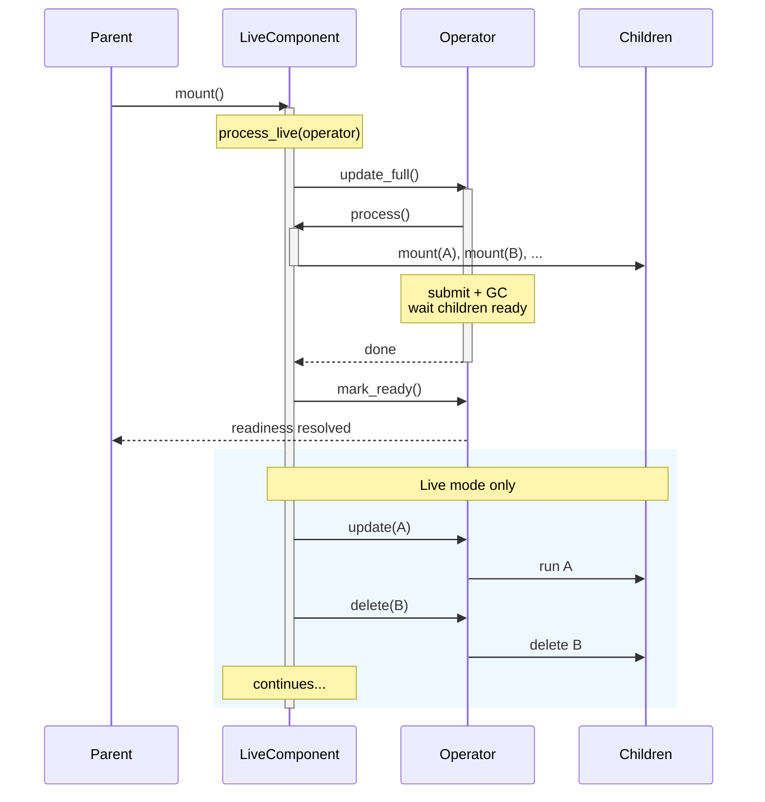

import LangTabs from '../../../components/LangTabs.astro';

By default, a [processing component](../programming_guide/processing_component) runs in **catch-up mode** — on each app update, it declares all target states and mounts all sub-components from scratch. CocoIndex handles incremental updates by skipping [memoized](../programming_guide/function) sub-components and reconciling target states at the end, then the component exits. This works well when the dataset is small enough to scan fully each cycle.

When the dataset is large or you need to react to changes continuously (e.g., watching a file system), you want the component itself to stay running and react incrementally. A **live component** does an initial full scan (same as catch-up mode), then keeps running and reacts to individual changes without rescanning everything.

<Lang only="python">

## The LiveComponent protocol

A live component is a class with three methods:

</Lang>

<Lang only="rust">

## The LiveComponent trait

A live component is a type that implements the `LiveComponent` trait, with two methods:

</Lang>

{/* Rust: rust/sdk/cocoindex/src/live_component.rs (LiveComponent trait), rust/sdk/cocoindex/tests/live_map.rs (Producer) */}
<LangTabs>
<Fragment slot="python">

```python
class MyLiveComponent:
    def __init__(self, folder: pathlib.Path, target: localfs.DirTarget) -> None:
        """Receive arguments from the mount() call."""
        self.folder = folder
        self.target = target

    async def process(self) -> None:
        """Full processing — mount all children, declare all target states."""
        ...

    async def process_live(self, operator: coco.LiveComponentOperator) -> None:
        """Continuous processing — orchestrate full and incremental updates."""
        ...
```

</Fragment>
<Fragment slot="rust">

```rust
use cocoindex::prelude::*;

struct MyLiveComponent {
    folder: PathBuf,
    target: DirTarget,
}

#[cocoindex::async_trait]
impl LiveComponent for MyLiveComponent {
    /// Full processing: mount all children, declare all target states.
    async fn process(&self, ctx: Ctx) -> Result<()> {
        // ...
        Ok(())
    }

    /// Continuous processing: orchestrate full and incremental updates.
    async fn process_live(&self, operator: LiveComponentOperator) -> Result<()> {
        operator.update_full().await?;
        operator.mark_ready().await;
        // ...
        Ok(())
    }
}
```

</Fragment>
</LangTabs>

<Lang only="python">

- **`__init__`** receives arguments passed to `coco.mount()`.
- **`process()`** does a full scan — mounts children via `coco.mount()` and declares target states, just like a traditional component function. Called indirectly via `operator.update_full()`.
- **`process_live(operator)`** is the long-running entry point. It orchestrates full and incremental updates using the operator.

CocoIndex detects a live component by checking if the class has both `process` and `process_live` methods.

</Lang>

<Lang only="rust">

- **The fields** hold the component's arguments: you build the value and pass it to `ctx.mount_live(&key, component)`.
- **`process(ctx)`** does a full scan — mounts children via `ctx.mount` / `ctx.mount_each` and declares target states, just like a traditional component function. Called indirectly via `operator.update_full()`.
- **`process_live(operator)`** is the long-running entry point. It orchestrates full and incremental updates using the operator. Its default body runs one full pass, then `mark_ready`.

The trait is the marker, and `ctx.mount_live` is the mount call.

</Lang>

## LiveComponentOperator

<Lang only="python">

The `operator` passed to `process_live()` provides five methods:

| Method | Description |
|--------|-------------|
| `await operator.update_full()` | Run `process()` with a full submission phase (GCs removed children). Blocks until fully ready. |
| `await operator.update(subpath, fn, *args, **kwargs)` | Mount a child component incrementally. |
| `await operator.delete(subpath)` | Delete a child component. |
| `await operator.mark_ready()` | Signal that processing has caught up to the time `process_live()` was called. |
| `await operator.report_exception(exc)` | Surface a `process_live`-body exception through the parent's exception handler chain. |

</Lang>

<Lang only="rust">

{/* Rust: rust/sdk/cocoindex/src/live_component.rs (LiveComponentOperator) */}

The `operator` passed to `process_live()` provides these methods, with the child's body as a closure:

| Method | Description |
|--------|-------------|
| `operator.update_full().await?` | Run `process()` with a full submission phase (GCs removed children). Blocks until fully ready. |
| `operator.update(key, \|ctx\| async move { .. }).await?` | Mount a child component under `key` incrementally. Awaits until its state has synced. |
| `operator.start_update(key, \|ctx\| ..).await?` | The same without waiting: returns a `ReadyHandle` whose `ready()` awaits the sync. |
| `operator.delete(key).await?` / `start_delete(key)` | Delete a child component, waiting for the sync or returning a `ReadyHandle`. |
| `operator.mark_ready().await` | Signal that processing has caught up to the time `process_live()` was called. |
| `operator.is_live()` | Whether the update runs in live mode. |
| `operator.read_committed_state(key)` / `write_committed_state(key, &value)` | A durable value of the component's own, such as a cursor, kept across runs. |

</Lang>

<RustNote>
There is no `report_exception` in Rust. Return the error from `process_live` instead: before `mark_ready`, the mount fails with it; after `mark_ready`, it is logged.
</RustNote>

### `update_full()`

Triggers a full processing cycle: calls `process()`, submits target states, waits for all children to be ready, and garbage-collects children that are no longer mounted. This is the same mechanism as a traditional component's update cycle.

<Lang only="python">Exceptions raised inside `process()` (including a failed `use_mount` child's, which surfaces there)</Lang><Lang only="rust">Errors returned from `process()`</Lang> are routed through the parent's [exception handler chain](./exception_handlers#exception-handlers) — same as background <Lang only="python">`coco.mount()`</Lang><Lang only="rust">`ctx.mount`</Lang> failures — and **do not propagate** to the caller. Components that `process()` mounts in the background report their own failures through the chain in effect where they are mounted, as any background mount does. This lets long-running `process_live` loops (such as periodic refreshers) keep going across transient cycle failures while still surfacing the failure to operators.

### `update()` and `delete()`

Mount or delete individual child components without a full scan. These are concurrent with each other but serialized with `update_full()` — if `update_full()` is running, incremental operations wait until it finishes.

When multiple operations target the same <Lang only="python">subpath</Lang><Lang only="rust">key</Lang>, only the latest one (by invocation order) takes effect.

Failures in the mounted child (or in the delete itself) are routed through the parent's [exception handler chain](./exception_handlers#exception-handlers) with <Lang only="python">`mount_kind="process_live"`</Lang><Lang only="rust">`mount_kind` set to `MountKind::Update` or `MountKind::Delete`</Lang> and `stable_path` set to the *child's* path — same shape as background <Lang only="python">`coco.mount`</Lang><Lang only="rust">`ctx.mount`</Lang> failures<Lang only="python">, never propagated to `handle.ready()`</Lang>. The live loop is unaffected by child failures.

### `mark_ready()`

Signals to the parent that the live component has caught up. The parent's <Lang only="python">`await handle.ready()`</Lang><Lang only="rust">`ctx.mount_live(...)` call</Lang> returns when `mark_ready()` is called. If `process_live()` returns without calling `mark_ready()`, it is called automatically.

### A catch-up update beside a running live update

A catch-up update of an app whose live update is still running leaves the live component running. The catch-up mounts its own instance of the component beside it, so two `process_live()` calls for one component can run at the same time: the live one, and the catch-up one, which ends at `mark_ready()`. Their full passes take turns, and an `update()` or `delete()` from the live one that arrives during the catch-up's full pass runs after that pass commits. If `process_live()` takes an exclusive resource (a lock, a port, a consumer group membership) before `mark_ready()`, the catch-up instance must be able to wait for it or do without it.

<Lang only="python">

### `report_exception()`

Routes an exception raised somewhere in `process_live`'s body (but **outside** an `update_full` / `update` / `delete` call) through the parent's [exception handler chain](./exception_handlers#exception-handlers). Use it for failures the framework can't see on its own, such as an external watcher emitting a malformed event:

```python
async def process_live(self, operator):
    await operator.update_full()
    await operator.mark_ready()
    async for event in watcher.events():
        try:
            subpath, value = parse_event(event)
        except ParseError as exc:
            await operator.report_exception(exc)
            continue
        await operator.update(subpath, process_one, value)
```

The handler receives an `ExceptionContext` with `mount_kind="process_live"` and `stable_path` set to the live component's own path. The full Python traceback is preserved (when `exc.__traceback__` is set — i.e. for caught exceptions). Falls back to ERROR-level logging if no handler is registered.

You **don't** need `report_exception` around `update_full` / `update` / `delete` themselves — those route their own errors automatically.

</Lang>

<Lang only="rust">

### Handling failures

`update_full`, `update` and `delete` route their failures through the handler chain, with `mount_kind` set to `MountKind::UpdateFull`, `MountKind::Update` or `MountKind::Delete`. Register a handler with `ctx.mount_live_with_handler(&key, component, handler)` for one component, with `ctx.with_exception_handler` for the mounts of one scope, or on the environment builder for all of them (see [Exception handlers](./exception_handlers#exception-handlers)).

</Lang>

## Example: file system watcher

A component that watches a local folder and processes each file:

{/* Rust: rust/sdk/cocoindex/tests/live_component.rs (DirectDelete), rust/sdk/cocoindex/tests/live_map.rs (Producer) */}
<LangTabs>
<Fragment slot="python">

```python
import pathlib
import cocoindex as coco

class FolderWatcher:
    def __init__(self, folder: pathlib.Path, target) -> None:
        self.folder = folder
        self.target = target

    async def process(self) -> None:
        """Full scan — mount a child for every file in the folder."""
        for path in self.folder.iterdir():
            if path.is_file():
                await coco.mount(
                    coco.component_subpath(path.name),
                    process_file,
                    path,
                    self.target,
                )

    async def process_live(self, operator: coco.LiveComponentOperator) -> None:
        # 1. Set up the file watcher before the full scan so no events are missed.
        watcher = setup_watchdog(self.folder)

        # 2. Full scan.
        await operator.update_full()

        # 3. Signal readiness — parent can proceed.
        await operator.mark_ready()

        # 4. React to changes.
        async for event in watcher.events():
            subpath = coco.component_subpath(event.filename)
            if event.is_update:
                await operator.update(subpath, process_file, event.path, self.target)
            elif event.is_delete:
                await operator.delete(subpath)
```

</Fragment>
<Fragment slot="rust">

```rust
struct FolderWatcher {
    source: Vec<(String, String)>,
    provider: TargetStateProvider<String>,
}

#[cocoindex::async_trait]
impl LiveComponent for FolderWatcher {
    /// Full scan: one child per entry of the source.
    async fn process(&self, ctx: Ctx) -> Result<()> {
        let provider = self.provider.clone();
        ctx.mount_each(
            self.source.clone(),
            |(k, _v): &(String, String)| k.clone(),
            move |child, (k, v)| {
                let provider = provider.clone();
                async move { declare_target_state(&child, provider.target_state(k, v)) }
            },
        )
        .await?;
        Ok(())
    }

    async fn process_live(&self, operator: LiveComponentOperator) -> Result<()> {
        // 1. Full scan.
        operator.update_full().await?;
        // 2. Signal readiness: the parent can proceed.
        operator.mark_ready().await;
        // 3. React to changes: delete the child mounted for key "a".
        operator.delete("a").await?;
        Ok(())
    }
}
```

For a real directory, `cocoindex` ships the watcher: `walk_dir(dir).live()` returns a `LiveMapView`, and `ctx.mount_each_live` mounts one child per file (see `examples/rust/text_embedding`). Write a `LiveComponent` by hand when the change source is your own.

</Fragment>
</LangTabs>

The parent mounts it like any other component:

{/* Rust: rust/sdk/cocoindex/tests/live_component.rs (mount_live_catch_up_runs_process_once) */}
<LangTabs>
<Fragment slot="python">

```python
@coco.fn
async def app_main(folder: pathlib.Path, outdir: pathlib.Path) -> None:
    # Set up the target in the parent (use_mount is not allowed inside process()).
    target = await localfs.mount_dir_target(outdir)
    # Mount the live component.
    await coco.mount(FolderWatcher, folder, target)
```

</Fragment>
<Fragment slot="rust">

```rust
app.update(move |ctx| async move {
    ctx.mount_live(&"comp", FolderWatcher { source, provider }).await
})
.await?;
```

`mount_live` returns when the component marks itself ready. In live mode the component keeps running in the background until the app is dropped.

</Fragment>
</LangTabs>

## Example: traditional component equivalent

A traditional single-function component:

{/* Rust: the body of rust/sdk/cocoindex/tests/live_component.rs (Declarer::process), inside an app.update root as in that file's tests */}
<LangTabs>
<Fragment slot="python">

```python
@coco.fn
async def process_all(data) -> None:
    for key, value in data.items():
        coco.declare_target_state(target.target_state(key, value))
```

</Fragment>
<Fragment slot="rust">

```rust
app.update(move |ctx| async move {
    for (k, v) in rows {
        declare_target_state(&ctx, provider.target_state(k, v.to_string()))?;
    }
    Ok(())
})
.await?;
```

</Fragment>
</LangTabs>

is equivalent to this LiveComponent:

{/* Rust: rust/sdk/cocoindex/tests/live_component.rs (Declarer) */}
<LangTabs>
<Fragment slot="python">

```python
class ProcessAll:
    def __init__(self, data):
        self.data = data

    async def process(self) -> None:
        for key, value in self.data.items():
            coco.declare_target_state(target.target_state(key, value))

    async def process_live(self, operator: coco.LiveComponentOperator) -> None:
        await operator.update_full()
        # mark_ready() is called automatically on return.
```

</Fragment>
<Fragment slot="rust">

```rust
struct ProcessAll {
    provider: TargetStateProvider<String>,
    rows: Vec<(&'static str, &'static str)>,
}

#[cocoindex::async_trait]
impl LiveComponent for ProcessAll {
    async fn process(&self, ctx: Ctx) -> Result<()> {
        for (k, v) in &self.rows {
            declare_target_state(&ctx, self.provider.target_state(*k, v.to_string()))?;
        }
        Ok(())
    }
    // The default `process_live` runs one full pass and marks the component ready.
}
```

</Fragment>
</LangTabs>

The key difference: the LiveComponent version can later be extended to handle incremental changes in `process_live()` without changing `process()`.

<Lang only="python">

## Example: periodic refresh with `coco.auto_refresh`

A common pattern is "run a regular processor on a fixed schedule." `coco.auto_refresh` wraps any processor function as a LiveComponent that re-runs it on an interval — no need to write `process_live` yourself.

</Lang>

<Lang only="rust">

## Example: periodic refresh with `ctx.auto_refresh`

{/* Keeps the anchor that the Rust copy of programming_guide/live_mode links to. */}
<span id="example-periodic-refresh-with-cocoauto_refresh"></span>

A common pattern is "run a regular processor on a fixed schedule." `ctx.auto_refresh` mounts a live component that re-runs a closure on an interval — no need to write `process_live` yourself.

</Lang>

{/* Rust: rust/sdk/cocoindex/tests/live_component.rs (auto_refresh), rust/sdk/cocoindex/src/ctx.rs (Ctx::auto_refresh) */}
<LangTabs>
<Fragment slot="python">

```python
import datetime
import cocoindex as coco

async def sync_users(db, target) -> None:
    rows = await db.fetch_all_users()
    for row in rows:
        target.declare_row(row=UserRow(...))

@coco.fn
async def app_main(db, target) -> None:
    await coco.mount(
        coco.auto_refresh(sync_users, interval=datetime.timedelta(minutes=5)),
        db, target,
    )
```

</Fragment>
<Fragment slot="rust">

```rust
use std::time::Duration;

ctx.auto_refresh(&"sync_users", Duration::from_secs(5 * 60), move |ctx| {
    let table = table.clone();
    async move {
        let rows = fetch_all_users(&ctx).await?;
        for row in rows {
            table.declare_row(&ctx, &row)?;
        }
        Ok(())
    }
})
.await?;
```

`ctx.auto_refresh(&key, interval, f)` mounts the refresh component under `key`. `f` is called with a fresh `Ctx` each cycle, so it must be `Fn` and `Clone`; clone the handles it needs into the closure.

</Fragment>
</LangTabs>

Behavior:
- The first cycle runs immediately, then `mark_ready` is signaled to the parent.
- In live mode, the loop continues: `sleep(interval) → run process_fn → ...` with a **fixed delay** between cycles (cycles never overlap; a slow cycle just stretches the gap).
- In catch-up mode, the first cycle runs and `auto_refresh` terminates — observationally identical to mounting `process_fn` directly. The interval is ignored.
- Cycle failures are routed through the parent's [exception handler chain](./exception_handlers#exception-handlers) (see `update_full()` above); the loop keeps going.
- **Each cycle reconciles target states against the previous cycle.** If `process_fn` no longer declares some target state (e.g. a row that vanished from your source table), CocoIndex automatically deletes the corresponding target — same garbage-collection model as a regular component re-run. You write the function as if processing from scratch each time; the framework handles the diff. See [Target State](../programming_guide/target_state) for the underlying model.

<Lang only="python">

The returned class's `__init__` accepts the same positional and keyword arguments as `process_fn` — anything you'd pass to `coco.mount(process_fn, ...)` you can pass to `coco.mount(coco.auto_refresh(process_fn, interval=...), ...)`.

</Lang>

<Lang only="rust">

Here `process_fn` is the closure passed to `ctx.auto_refresh`.

</Lang>

## LiveMapFeed and LiveMapView
:::tip
For an introduction to live mode, see [Live Mode](../programming_guide/live_mode). Connector authors can implement the protocols below to supply live collections.
:::

Two <Lang only="python">protocols</Lang><Lang only="rust">traits</Lang> represent live keyed collections that <Lang only="python">`mount_each()`</Lang><Lang only="rust">`ctx.mount_each_live`</Lang> can consume. Choose based on whether your source can enumerate its current state:

- **`LiveMapView`** — the source has enumerable current state that can be scanned (e.g., a directory listing, database table). Supports both full scans via <Lang only="python">`__aiter__()`</Lang><Lang only="rust">`scan()`</Lang> and incremental changes via `watch()`.
- **`LiveMapFeed`** — the source only streams changes, with no "current state" to scan (e.g., a Kafka consumer, a webhook event stream). Provides only `watch()`.

{/* Rust: rust/sdk/cocoindex/src/live_component.rs (LiveMapFeed, LiveMapView) */}
<LangTabs>
<Fragment slot="python">

```python
class LiveMapFeed(Protocol[K, V]):
    async def watch(self, subscriber: LiveMapSubscriber[K, V]) -> None: ...

class LiveMapView(LiveMapFeed[K, V], Protocol[K, V]):
    def __aiter__(self) -> AsyncIterator[tuple[K, V]]: ...
```

</Fragment>
<Fragment slot="rust">

```rust
#[async_trait]
pub trait LiveMapFeed<K, V>: Send + Sync + 'static {
    /// Stream changes to `subscriber` until cancelled. Call
    /// `subscriber.mark_ready()` once caught up.
    async fn watch(&self, subscriber: LiveMapSubscriber<K, V>) -> Result<()>;

    /// Whether to skip the initial catch-up scan in live mode. Defaults to `false`.
    async fn skip_initial_scan(&self, _operator: &LiveComponentOperator) -> Result<bool> {
        Ok(false)
    }
}

#[async_trait]
pub trait LiveMapView<K, V>: LiveMapFeed<K, V> {
    /// All current `(key, value)` pairs, for the catch-up full pass and re-scans.
    async fn scan(&self) -> Result<Vec<(K, V)>>;
}
```

</Fragment>
</LangTabs>

<Lang only="python">

`LiveMapView` extends `LiveMapFeed` — any `LiveMapView` is also a valid `LiveMapFeed`. When `mount_each()` receives either protocol as its `items` argument, it automatically creates an internal `LiveComponent`:

- **`LiveMapView`**: `__aiter__()` yields all `(key, value)` pairs for full scans (called inside the internal `process()`). `watch()` handles the full lifecycle.
- **`LiveMapFeed`**: `process()` is a no-op (no snapshot to scan). All work happens in `watch()`.

</Lang>

<Lang only="rust">

`LiveMapView` extends `LiveMapFeed`. `ctx.mount_each_live(&key, feed, process_fn)` takes a `LiveMapView` and creates an internal `LiveComponent`: `scan()` yields all `(key, value)` pairs for full scans (called inside the internal `process()`), and `watch()` handles the incremental changes. A watch-only source implements `scan` as an empty snapshot, so everything arrives through `watch()`. A durable feed can override `skip_initial_scan` to resume from a cursor it kept with `operator.read_committed_state`.

</Lang>

<RustNote>
The live mount is a separate method, `ctx.mount_each_live`; `ctx.mount_each` and `ctx.mount_each_stream` only take a plain collection or stream of items.
</RustNote>

### LiveMapSubscriber

The `subscriber` passed to `watch()` mirrors `LiveComponentOperator`:

<Lang only="python">

| LiveMapSubscriber | LiveComponentOperator | Description |
|---|---|---|
| `await subscriber.update_all()` | `await operator.update_full()` | Full re-scan of all items |
| `await subscriber.mark_ready()` | `await operator.mark_ready()` | Signal readiness |
| `await subscriber.update(key, value)` | `await operator.update(subpath, fn, ...)` | Incremental update; returns `ComponentMountHandle` |
| `await subscriber.delete(key)` | `await operator.delete(subpath)` | Incremental delete; returns `ComponentMountHandle` |

</Lang>

<Lang only="rust">

{/* Rust: rust/sdk/cocoindex/src/live_component.rs (LiveMapSubscriber) */}

| LiveMapSubscriber | LiveComponentOperator | Description |
|---|---|---|
| `subscriber.update_all().await?` | `operator.update_full().await?` | Full re-scan of all items |
| `subscriber.mark_ready().await` | `operator.mark_ready().await` | Signal readiness |
| `subscriber.update(key, value).await?` | `operator.update(key, f).await?` | Incremental update; awaits until the child's state has synced |
| `subscriber.delete(key).await?` | `operator.delete(key).await?` | Incremental delete; awaits until the deletion has synced |
| `subscriber.start_update(key, value).await?` / `start_delete(key)` | `operator.start_update` / `start_delete` | The same without waiting; returns a `ReadyHandle` |

The subscriber also has `is_live()`, and `read_committed_state` / `write_committed_state` for the feed's own durable cursor.

</Lang>

A typical `watch()` implementation for a `LiveMapView`:

{/* Rust: rust/sdk/cocoindex/tests/live_component.rs (StreamFeed) */}
<LangTabs>
<Fragment slot="python">

```python
async def watch(self, subscriber: LiveMapSubscriber[K, V]) -> None:
    await subscriber.update_all()     # initial full scan
    await subscriber.mark_ready()     # signal readiness
    # ... watch for changes and call subscriber.update()/delete() ...
```

</Fragment>
<Fragment slot="rust">

```rust
/// Watch-only stream: emits a fixed set of incremental updates after readiness.
struct StreamFeed {
    items: Vec<(String, i64)>,
}

#[async_trait]
impl LiveMapFeed<String, i64> for StreamFeed {
    async fn watch(&self, subscriber: LiveMapSubscriber<String, i64>) -> Result<()> {
        subscriber.mark_ready().await;
        for (k, v) in &self.items {
            subscriber.update(k.clone(), *v).await?;
        }
        Ok(())
    }
}

#[async_trait]
impl LiveMapView<String, i64> for StreamFeed {
    async fn scan(&self) -> Result<Vec<(String, i64)>> {
        // Empty initial snapshot; everything arrives via watch().
        Ok(Vec::new())
    }
}
```

The framework runs the initial scan itself, before `watch()`, so `watch()` starts with `mark_ready`.

</Fragment>
</LangTabs>

### Implementing live support for a connector

To add live support to a source connector, make your source return <Lang only="python">an object that implements</Lang><Lang only="rust">a type that implements</Lang> `LiveMapView` (if the source has scannable state) or `LiveMapFeed` (if it only streams changes):

<Lang only="python">

- **`LiveMapView` example**: The [`localfs`](../connectors/localfs) connector's `DirWalker` — `walk_dir(..., live=True).items()` returns a `LiveMapView` backed by `watchfiles`.
- **`LiveMapFeed` example**: The [`kafka`](../connectors/kafka) connector — `topic_as_map()` returns a `LiveMapFeed` that consumes messages from a Kafka topic.

</Lang>

<Lang only="rust">

{/* Rust: rust/sdk/cocoindex/src/resources/fs.rs (DirWalker::live), src/connectors/kafka.rs (KafkaTopicMap), src/resources/live_map.rs */}

- **`LiveMapView` example**: The [`localfs`](../connectors/localfs) walker — `walk_dir(dir).live()` (feature `fs_live`) returns a `LiveMapView`.
- **`LiveMapView` over a stream**: The [`kafka`](../connectors/kafka) connector — `kafka::topic_as_map(&consumer, topic)` implements `LiveMapView`, with a scan that reads the latest message per key.
- **In-process**: `LiveMap<K, V>`, described below.

</Lang>

<Lang only="rust">

### LiveMap: an in-process live source

`LiveMap<K, V>` joins live data-*producing* logic and live data-*consuming* logic inside one session. The producer declares `(key, value)` entries as target states with `declare_entry`; the consumer reads the map as a `LiveMapView` through `ctx.mount_each_live`. An entry exists as long as some component declares it; when its declaring component stops declaring it, the entry is removed, and the consumer's child for it is deleted.

{/* Rust: rust/sdk/cocoindex/tests/live_map.rs (Producer, Consumer), rust/sdk/cocoindex/src/resources/live_map.rs */}
```rust
use cocoindex::prelude::*;

/// Declares every entry of `source`.
struct Producer {
    lm: LiveMap<String, String>,
    source: Vec<(String, String)>,
}

#[cocoindex::async_trait]
impl LiveComponent for Producer {
    async fn process(&self, ctx: Ctx) -> Result<()> {
        for (key, value) in self.source.clone() {
            self.lm.declare_entry(&ctx, key, value)?;
        }
        Ok(())
    }
}

/// Consumes the map: one child per entry.
struct Consumer {
    lm: LiveMap<String, String>,
}

#[cocoindex::async_trait]
impl LiveComponent for Consumer {
    async fn process(&self, ctx: Ctx) -> Result<()> {
        ctx.mount_each_live(&"each", self.lm.clone(), move |_ctx, value: String| async move {
            // ... process one entry ...
            Ok(())
        })
        .await
    }
}

// Inside the component tree:
let lm: LiveMap<String, String> = LiveMap::create(&ctx).await?;
```

`LiveMap::create(&ctx)` mounts the map's backing container target. The map is an in-memory, live-mode primitive, not state that persists across runs.

</Lang>

### Single-subscriber contract

A live feed (`LiveMapView`, `LiveMapFeed`, or `LiveStream`) is **single-subscriber**. Its `watch()` typically owns an exclusive underlying resource (a consumer subscription, an OS file watch, a single in-memory change channel) that can't be fanned out to two concurrent callers — e.g. two subscriptions would race one consumer's offset commits. So a given feed instance supports **one active `watch()` (one <Lang only="python">`mount_each`</Lang><Lang only="rust">`mount_each_live`</Lang>) at a time**; consuming it from two places concurrently is unsupported. Fan-out to multiple subscribers, if ever needed, belongs in a layer above the feed.

Enforce this in your `watch()` with <Lang only="python">`cocoindex.connectorkits.SingleWatcherGuard`, which raises `RuntimeError` on a second concurrent call</Lang><Lang only="rust">`cocoindex::live_component::SingleWatcherGuard`, which returns an error on a second concurrent call</Lang>:

{/* Rust: rust/sdk/cocoindex/src/live_component.rs (SingleWatcherGuard doc comment) */}
<LangTabs>
<Fragment slot="python">

```python
from cocoindex.connectorkits import SingleWatcherGuard

class MyView:
    def __init__(self, ...) -> None:
        self._watch_guard = SingleWatcherGuard("MyView")

    async def watch(self, subscriber) -> None:
        with self._watch_guard:
            ...  # existing body
```

</Fragment>
<Fragment slot="rust">

```rust
struct MyFeed { watch_guard: SingleWatcherGuard, /* ... */ }

#[async_trait]
impl LiveMapFeed<String, Vec<u8>> for MyFeed {
    async fn watch(&self, subscriber: LiveMapSubscriber<String, Vec<u8>>) -> Result<()> {
        let _token = self.watch_guard.enter()?;
        // ... body ...
    }
}
```

Build the guard with `SingleWatcherGuard::new("MyFeed")`. `enter()` returns an error on a second concurrent `watch()`; the flag clears when the token drops, on return, error or cancellation.

</Fragment>
</LangTabs>

## LiveStream

Some change sources are not naturally keyed maps — they deliver opaque event payloads (e.g. cloud-storage event notifications, raw message buses) that the consuming connector translates into map updates on its own terms. For these, CocoIndex provides **`LiveStream`**: a keyless sibling of `LiveMapFeed` — an unkeyed sequence of messages without any "key" or "delete" semantics. Connectors typically wrap a user-supplied `LiveStream` into their own `LiveMapView` (or `LiveMapFeed`) by translating each event into the appropriate key-level operation.

{/* Rust: rust/sdk/cocoindex/src/live_component.rs (LiveStream, LiveStreamSubscriber, ReadyHandle) */}
<LangTabs>
<Fragment slot="python">

```python
class LiveStream(Protocol[M]):
    async def watch(self, subscriber: LiveStreamSubscriber[M]) -> None: ...

class LiveStreamSubscriber(Protocol[M]):
    async def send(self, message: M) -> ReadyAwaitable: ...
    async def mark_ready(self) -> None: ...
```

</Fragment>
<Fragment slot="rust">

```rust
#[async_trait]
pub trait LiveStream<M: Send + 'static>: Send + Sync + 'static {
    /// Deliver messages to `subscriber` until cancelled.
    async fn watch(&self, subscriber: &dyn LiveStreamSubscriber<M>) -> Result<()>;
}

#[async_trait]
pub trait LiveStreamSubscriber<M>: Send + Sync {
    async fn send(&self, message: M) -> Result<ReadyHandle>;
    async fn mark_ready(&self);
    // Also `read_committed_state` / `write_committed_state`, with
    // defaults that keep nothing, for a stream's own durable cursor.
}
```

A subscriber returns `ReadyHandle::immediate()` for a message that needs no work, and `ReadyHandle::from_future(..)` (for example the handle of `LiveMapSubscriber::start_update`) otherwise.

</Fragment>
</LangTabs>

`send()` is awaited by the producer to obtain a <Lang only="python">`ReadyAwaitable`</Lang><Lang only="rust">`ReadyHandle`</Lang> handle; the handle's `ready()` is then awaited later (often by an internal offset/commit tracker) to signal that the message has been fully processed. The stream awaits each `send()` inline, so a slow subscriber naturally throttles the producer — at most one message is in flight per stream, bounding adapter memory regardless of producer rate.

`mark_ready()` must return promptly — it is awaited inline in the producer's loop. Subscribers that need to wait on additional preconditions (e.g. a pending scan) should spawn a background task and return.

### Implementing a LiveStream-based connector

A connector built on `LiveStream` typically:

1. Accepts a user-supplied <Lang only="python">`LiveStream[...]` as a constructor argument</Lang><Lang only="rust">`LiveStream<...>` as an argument</Lang> — the user wires up the underlying transport.
2. Wraps the stream into a `LiveMapView` (or `LiveMapFeed`): <Lang only="python">`__aiter__()`</Lang><Lang only="rust">`scan()`</Lang> runs an initial scan if the source has scannable state; `watch()` subscribes to the stream and translates each event into `subscriber.update(key, value)` / `subscriber.delete(key)`<Lang only="rust"> (or their `start_*` forms, whose `ReadyHandle` the stream awaits before it acknowledges the event)</Lang>.
3. Lets the underlying `LiveStream` handle offset commits, readiness signaling, and back-pressure.
4. Guards its `watch()` against concurrent subscription — see [Single-subscriber contract](#single-subscriber-contract) — with `SingleWatcherGuard`.

<Lang only="python">

**Example**: The [`oci_object_storage`](../connectors/oci_object_storage#live-bucket-watching) connector takes a `LiveStream[bytes]` (typically [`kafka.topic_as_stream(...).payloads()`](../connectors/kafka#as-a-live-stream)) and translates OCI Object Storage events into bucket-keyed updates.

</Lang>

<Lang only="rust">

{/* Rust: rust/sdk/cocoindex/src/connectors/oci_object_storage.rs (list_objects_live), src/connectors/kafka.rs (topic_as_stream, KafkaTopicStream::payloads) */}

**Example**: The [`oci_object_storage`](../connectors/oci_object_storage#live-bucket-watching) connector's `list_objects_live` takes a `LiveStream<Vec<u8>>` of event payloads (typically [`kafka::topic_as_stream(..).payloads()`](../connectors/kafka#as-a-live-stream)) and translates OCI Object Storage events into bucket-keyed updates.

</Lang>

The Kafka connector exposes `topic_as_stream()` precisely so that downstream connectors like this one can plug into Kafka without inheriting the keyed-map semantics of `topic_as_map()`.

## Live mode vs catch-up mode

See [Live Mode](../programming_guide/live_mode) for how the two modes are enabled at the app level and an overview of how they work.

For a manual `LiveComponent`, the mode controls whether `process_live()` continues running after `mark_ready()`:

<Lang only="python">

- **Live mode** (`live=True`): `process_live()` continues after `mark_ready()` — the component keeps watching for changes.
- **Catch-up mode** (`live=False`, default): `process_live()` terminates as soon as `mark_ready()` is awaited. No code after `await operator.mark_ready()` executes, so the component behaves like a traditional one-shot processor.

This lets you use the same `LiveComponent` class in both modes without code changes.

</Lang>

<Lang only="rust">

- **Live mode** (`UpdateOptions { live: true, .. }` on `app.update_with_options(..)`, or `cocoindex update -L`): `process_live()` continues after `mark_ready()` — the component keeps watching for changes.
- **Catch-up mode** (the default): `process_live()` terminates as soon as `mark_ready()` is awaited. No code after `operator.mark_ready().await` executes, so the component behaves like a traditional one-shot processor.

This lets you use the same `LiveComponent` type in both modes without code changes. `operator.is_live()` tells the body which mode it runs in.

</Lang>

## Restrictions

<Lang only="python">

### No `use_mount()` inside `process()`

`process()` may only call `coco.mount()` (background child mounts). Any setup that requires `use_mount()` (such as declaring target tables) must be done in the **parent** component before mounting the LiveComponent. This keeps the controller's provider set stable across full and incremental updates.

### Not allowed in `use_mount()`

LiveComponent classes can only be used with `coco.mount()` and `operator.update()`. Passing a LiveComponent class to `coco.use_mount()` raises a `TypeError`.

:::tip
While LiveComponent classes cannot be passed to `mount_each()`, use a [`LiveMapFeed` or `LiveMapView`](#livemapfeed-and-livemapview) — `mount_each()` automatically creates an internal LiveComponent when it detects one.
:::

</Lang>

<Lang only="rust">

### No `use_mount!` inside `process()`

`process()` may only mount background children (`ctx.mount`, `mount!`, `ctx.mount_each`, `mount_each!`). Any setup that requires `ctx.scope` / `use_mount!` (such as declaring target tables) must be done in the **parent** component before mounting the LiveComponent. This keeps the controller's provider set stable across full and incremental updates.

### Mounting a LiveComponent

A `LiveComponent` is mounted only with `ctx.mount_live` (or `ctx.mount_live_with_handler`). To mount one live component per item, use `ctx.mount_each_live_component(items, key_fn, make_component)`; to fan one feed out into closure-driven children, use `ctx.mount_each_live`.

</Lang>

## Readiness

The parent's <Lang only="python">`await handle.ready()`</Lang><Lang only="rust">`ctx.mount_live(...)` call</Lang> returns when `mark_ready()` is called inside `process_live()`, regardless of whether `process_live()` is still running.



If `process_live()` returns without calling `mark_ready()`, it is called automatically — the parent will not hang.
